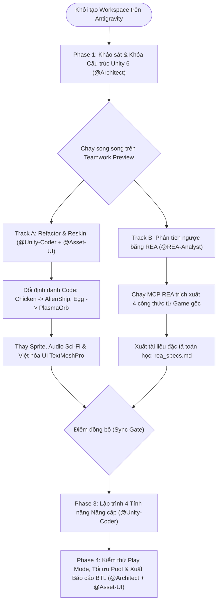

# 🚀 ANTIGRAVITY WORKFLOW & TEAMWORK PREVIEW PLAN
**Dự án:** Star Vanguard - Chiến Cơ Không Gian (2D Space Shooter trên Unity 6)  
**Nền tảng mã nguồn cơ sở:** `Nadir0702/ChickenInvaders-Unity` (Unity 6000.0.54f1)  
**Công cụ phân tích & nâng cấp:** `morluto/rea` (Reverse Engineer Anything via MCP)  
**Môi trường điều phối:** Antigravity (Multi-Agent / Teamwork Preview)

---

## 1. Kiến trúc Đội ngũ Agent trong Antigravity (Teamwork Preview Roles)

Khi bật chế độ **Teamwork Preview** trên Antigravity, dự án được chia cho **4 Agent chuyên biệt** phối hợp song song thông qua các Artifact chung (`task.md`, `implementation_plan.md`, `rea_specs.md`):

| Role / Agent | Nhiệm vụ cốt lõi (Core Responsibilities) | Quyền hạn File / Thư mục (Scope Lock) |
| :--- | :--- | :--- |
| **1. Lead Architect (`@Architect`)** | • Quản lý `implementation_plan.md` và phân rã Task.<br>• Kiểm soát kiến trúc SOLID, Interface (`IDamageable`, `IPoolable`) và duyệt PR/Diff từ các Agent khác.<br>• Bảo vệ toàn vẹn các file `.meta` và GUID của Unity 6. | Toàn quyền đọc; Ghi vào `Docs/`, `Plans/`, và duyệt cấu trúc `Assets/Scripts/Core/`. |
| **2. REA Reverse Specialist (`@REA-Analyst`)** | • Vận hành MCP `rea-agents` để phân tích nhị phân/assembly của bản gốc *Chicken Invaders* hoặc các bản build mẫu.<br>• Trích xuất công thức toán học (Overheat, Bezier Path, Loot Table, Boss AI) ra file đặc tả `rea_specs.md`. | Chỉ làm việc trên `Docs/REA_Specs/` và chạy CLI/MCP `rea`. Không sửa trực tiếp Scene/Prefab Unity. |
| **3. Core C# Developer (`@Unity-Coder`)** | • Refactor tên class/biến từ chủ đề "Gà" sang "Tàu vũ trụ" (giữ nguyên `[FormerlySerializedAs]` nếu cần).<br>• Chuyển hóa công thức từ `rea_specs.md` thành các script C# mới (`WeaponOverheat.cs`, `BezierMover.cs`, `PityLootSystem.cs`). | `Assets/Scripts/**` (Trừ các file `.unity` và `.prefab` đang mở bởi Integrator). |
| **4. Asset & UI Integrator (`@Asset-UI`)** | • Ánh xạ Sprite mới (Kenney Space Shooter / FoozleCC), âm thanh Sci-Fi và Việt hóa `TextMeshPro` UI.<br>• Cập nhật thông số Inspector, Prefab, Collider2D và viết kịch bản kiểm thử nghiệm thu (`walkthrough.md`). | `Assets/Prefabs/**`, `Assets/Sprites/**`, `Assets/Audio/**`, `Assets/Scenes/**`. |

---

## 2. Sơ đồ Luồng Công việc (Antigravity Teamwork Pipeline)



---

## 3. Kế hoạch Triển khai Chi tiết theo Từng Giai đoạn (Phases)

### Phase 1: Khởi tạo & Bảo vệ Liên kết Unity (Workspace Setup)
*   **Mục tiêu:** Đưa repo `Nadir0702/ChickenInvaders-Unity` vào Antigravity và thiết lập quy tắc an toàn cho Unity 6.
*   **Quy tắc bắt buộc (Guardrails cho mọi Agent):**
    1.  **Tuyệt đối không xóa file `.meta`** khi thay thế hình ảnh `.png` hoặc âm thanh `.wav` (chỉ ghi đè file cùng tên hoặc sửa qua Unity Editor) để tránh lỗi *Missing Reference* trên Prefab.
    2.  Khi đổi tên biến `public` hoặc `[SerializeField]` trong C#, bắt buộc gắn thuộc tính `[UnityEngine.Serialization.FormerlySerializedAs("oldName")]` trước khi dọn dẹp để không mất dữ liệu cấu hình trong Scene/Prefab.
    3.  Mọi Agent phải cập nhật trạng thái vào `task.md` sau mỗi bước.

---

### Phase 2: Thực thi Song song (Parallel Tracks trên Teamwork Preview)

#### Nhánh A: Tái cấu trúc Mã nguồn & Thay áo Đồ họa (`@Unity-Coder` & `@Asset-UI`)
*   [ ] **Task A1 (Refactor Identifiers):**
    *   Đổi tên lớp và tham chiếu: `Chicken` $
ightarrow$ `AlienFighter`, `Egg` $
ightarrow$ `PlasmaProjectile`, `Food` $
ightarrow$ `EnergyCrystal`, `Feather` $
ightarrow$ `HullDebris`.
    *   Đổi tên file lưu JSON trong `LeaderboardManager.cs` thành `star_vanguard_leaderboard.json`.
*   [ ] **Task A2 (Asset Replacement):**
    *   Thay thế toàn bộ Sprite con gà trong `Assets/Sprites/` bằng bộ **Kenney Space Shooter Redux** / **FoozleCC Void Fleet**.
    *   Thay thế âm thanh tiếng gà kêu trong `AudioManager` bằng âm thanh bắn tia Laser và tiếng nổ phi thuyền.
*   [ ] **Task A3 (UI Localization):**
    *   Việt hóa các màn hình Menu, Pause, HUD và Bảng xếp hạng sang chủ đề **Star Vanguard - Chiến Cơ Không Gian**.

#### Nhánh B: Khai thác Đặc tả Kỹ thuật bằng REA (`@REA-Analyst`)
*   [ ] **Task B1 (Weapon Overheat Mechanics):**
    *   Dùng `rea` phân tích hàm tăng nhiệt mỗi phát bắn ($\Delta H_{shot}$), tốc độ tản nhiệt tự nhiên ($C_{rate} \cdot \Delta t$), và thời gian khóa súng khi quá nhiệt ($T_{penalty}$).
*   [ ] **Task B2 (Spline / Bezier Wave Trajectories):**
    *   Trích xuất bộ tọa độ điểm điều khiển (Control Points $P_0, P_1, P_2, P_3$) của các đợt quái bay lượn xoắn ốc trước khi vào đội hình lưới.
*   [ ] **Task B3 (Dynamic Loot Drop & Pity Timer):**
    *   Phân tích thuật toán rơi hộp quà nâng cấp đạn (tăng xác suất rơi nếu người chơi qua $N$ con quái chưa nhận được nâng cấp).
*   [ ] **Task B4 (Multi-Phase Boss State Machine):**
    *   Trích xuất ngưỡng máu chuyển giai đoạn của Boss (100% $
ightarrow$ 65% $
ightarrow$ 30%) và công thức bắn đạn tỏa tròn $N$-way.
*   *Đầu ra:* File `Docs/REA_Specs/rea_extracted_formulas.md`.

---

### Phase 3: Tích hợp 4 Tính năng Nâng cấp vào Unity 6 (`@Unity-Coder`)

Sau khi Nhánh A và Nhánh B hoàn tất tại **Sync Gate**, `@Unity-Coder` đọc `rea_extracted_formulas.md` để nâng cấp dự án vượt lên trên bản gốc của `Nadir0702`:

1.  **Module 1: `WeaponHeatController.cs` (Hệ thống Quá nhiệt Vũ khí)**
    *   Tích hợp vào hệ thống bắn của Player; phát sự kiện `OnHeatChanged(float normalizedHeat)` và `OnOverheated(bool isLocked)` cho `UIManager` hiển thị thanh nhiệt.
2.  **Module 2: Mở rộng `EnemyMover.cs` & `WaveDirector.cs` với Cubic Bezier**
    *   Bổ sung công thức đường cong Bezier bậc 3:
        $$B(t) = (1-t)^3 P_0 + 3(1-t)^2 t P_1 + 3(1-t) t^2 P_2 + t^3 P_3, \quad t \in [0, 1]$$
    *   Thêm Wave thứ 7 hoặc xen kẽ quỹ đạo Bezier vào chu kỳ 6 Wave hiện có.
3.  **Module 3: Nâng cấp `PickupManager.cs` với Pity Counter**
    *   Bổ sung bộ đếm `killsSinceLastPowerUp` đảm bảo tính cân bằng gameplay.
4.  **Module 4: Nâng cấp `BossAttackController.cs` (Multi-Phase Bullet Hell)**
    *   Tận dụng `PoolManager` có sẵn để bắn đạn vòng tròn xoắn ốc khi máu Boss xuống dưới 50%.

---

### Phase 4: Kiểm thử Nghiệm thu & Đóng gói Báo cáo BTL (`@Architect` & `@Asset-UI`)
*   [ ] Kiểm tra `PoolManager`: Đảm bảo toàn bộ đạn mới của Boss và hiệu ứng mảnh vỡ đều thực thi `IPoolable`, không phát sinh rác bộ nhớ (`GC.Alloc` = 0 khi chiến đấu).
*   [ ] Chạy thử nghiệm 6+ Wave liên tục và màn chuyển cảnh `Light Speed`.
*   [ ] Xuất bộ sơ đồ Use Case, Class Diagram, Sequence Diagram khớp 100% với code sau khi nâng cấp để chèn vào báo cáo Word.

---

## 4. Bộ Prompt Mẫu để Kích hoạt Nhanh trên Antigravity (Copy & Paste)

Bạn có thể copy trực tiếp các khối lệnh dưới đây vào Antigravity để điều phối công việc:

### Prompt 1: Khởi tạo Antigravity & Bật Teamwork Preview
> ```text
> @Workspace Hãy đọc file ANTIGRAVITY_TEAMWORK_PLAN.md. Khởi tạo chế độ Teamwork Preview với 4 vai trò: @Architect, @REA-Analyst, @Unity-Coder, và @Asset-UI. 
> Bước đầu tiên: @Architect hãy quét toàn bộ thư mục Assets/Scripts/ của project Unity 6 hiện tại, lập danh sách các file C# cần đổi tên định danh (Reskin từ Chicken Invaders sang Star Vanguard) và tạo artifact task.md để phân công song song cho @Unity-Coder và @REA-Analyst. Lưu ý: Tuyệt đối giữ nguyên toàn bộ file .meta của Unity.
> ```

### Prompt 2: Giao việc cho `@REA-Analyst` trích xuất tính năng
> ```text
> @REA-Analyst Sử dụng bộ công cụ MCP rea-agents để phân tích cơ chế Weapon Overheat (tốc độ tăng nhiệt mỗi viên đạn, hàm làm mát theo thời gian, thời gian phạt khi quá nhiệt) và công thức quỹ đạo bay Bezier của đàn quái từ bản mẫu. Hãy tổng hợp bằng chứng (evidence) và xuất ra công thức toán học kèm mã giả vào file Docs/REA_Specs/rea_extracted_formulas.md để @Unity-Coder sử dụng.
> ```

### Prompt 3: Giao việc cho `@Unity-Coder` triển khai tính năng mới
> ```text
> @Unity-Coder Dựa trên đặc tả trong Docs/REA_Specs/rea_extracted_formulas.md và kiến trúc hiện tại của project (GameManager, PoolManager, WaveDirector, EnemyMover, IDamageable, IPoolable):
> 1. Viết script WeaponHeatController.cs tích hợp vào tàu của người chơi và kết nối qua C# Event với UI.
> 2. Bổ sung kiểu di chuyển Cubic Bezier Curve vào EnemyMover.cs và đăng ký thêm mẫu đội hình mới trong WaveDirector.cs.
> Đảm bảo tuân thủ nguyên lý Single Responsibility và không phá vỡ liên kết Inspector hiện có.
> ```
