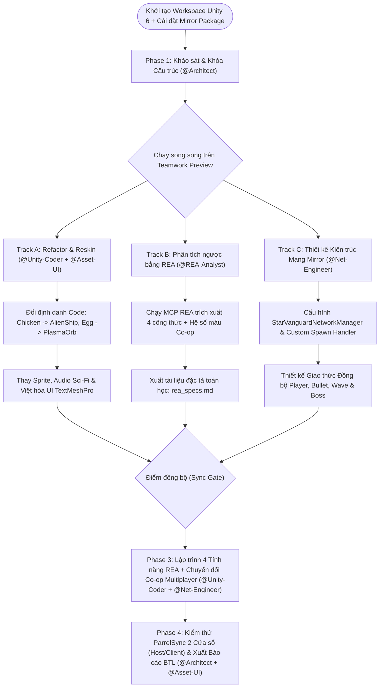

# 🚀 ANTIGRAVITY WORKFLOW & TEAMWORK PREVIEW PLAN (MIRROR MULTIPLAYER EDITION)

* **Dự án:** Star Vanguard Online - Chiến Cơ Không Gian Co-op (2D Space Shooter trên Unity 6)
* **Nền tảng mã nguồn cơ sở:** `Nadir0702/ChickenInvaders-Unity` (Unity `6000.0.54f1`)
* **Thư viện Mạng (Networking):** **Mirror Networking** (Host/Client Architecture - KCP/Telepathy Transport)
* **Công cụ phân tích & nâng cấp:** `morluto/rea` (Reverse Engineer Anything via MCP)
* **Môi trường điều phối:** Antigravity (Multi-Agent / Teamwork Preview)

---

## 1. Kiến trúc Đội ngũ Agent trong Antigravity (5 Roles cho Teamwork Preview)

Khi bật chế độ **Teamwork Preview** trên Antigravity, dự án được chia cho **5 Agent chuyên biệt** phối hợp song song thông qua các Artifact chung (`task.md`, `implementation_plan.md`, `rea_specs.md`, `network_specs.md`):

| Role / Agent | Nhiệm vụ cốt lõi (Core Responsibilities) | Quyền hạn File / Thư mục (Scope Lock) |
| :--- | :--- | :--- |
| **1. Lead Architect (`@Architect`)** | • Quản lý `implementation_plan.md` và phân rã Task.<br>• Kiểm soát kiến trúc SOLID, Interface (`IDamageable`, `IPoolable`) và kiến trúc Server-Authoritative của Mirror.<br>• Bảo vệ toàn vẹn các file `.meta` và GUID của Unity 6. | Toàn quyền đọc; Ghi vào `Docs/`, `Plans/`, và duyệt cấu trúc `Assets/Scripts/Core/`. |
| **2. REA Reverse Specialist (`@REA-Analyst`)** | • Vận hành MCP `rea-agents` để phân tích nhị phân/assembly của bản gốc *Chicken Invaders* (hoặc *Chicken Invaders Universe*).<br>• Trích xuất công thức toán học (Overheat, Bezier Path, Loot Table, Boss AI, Co-op Scaling) ra file `rea_specs.md`. | Chỉ làm việc trên `Docs/REA_Specs/` và chạy CLI/MCP `rea`. Không sửa trực tiếp Scene/Prefab Unity. |
| **3. Core C# Developer (`@Unity-Coder`)** | • Refactor tên class/biến từ chủ đề "Gà" sang "Tàu vũ trụ" (giữ nguyên `[FormerlySerializedAs]`).<br>• Chuyển hóa công thức từ `rea_specs.md` thành các script C# mới (`WeaponHeatController.cs`, `BezierMover.cs`, `PityLootSystem.cs`). | `Assets/Scripts/Player/`, `Assets/Scripts/Enemies/`, `Assets/Scripts/Waves/`. |
| **4. Mirror Network Engineer (`@Net-Engineer`)** | • Tích hợp **Mirror Networking**: Xây dựng `StarVanguardNetworkManager`, chuyển đổi các lớp quan trọng sang `NetworkBehaviour`.<br>• Đồng bộ vị trí tàu (`NetworkTransform`), bắn đạn qua `[Command]` & `[ClientRpc]`, tích hợp `PoolManager` với `NetworkClient.RegisterPrefab`. | `Assets/Scripts/Networking/`, nâng cấp `PoolManager.cs`, `WaveDirector.cs`, `PlayerController.cs`. |
| **5. Asset & UI Integrator (`@Asset-UI`)** | • Ánh xạ Sprite mới (Kenney Space Shooter / FoozleCC), âm thanh Sci-Fi và Việt hóa `TextMeshPro` UI.<br>• Thiết kế **Multiplayer Lobby UI** (Tạo phòng Host, Nhập IP Join Client, HUD hiển thị máu/điểm của 2-4 người chơi). | `Assets/Prefabs/**`, `Assets/Sprites/**`, `Assets/Audio/**`, `Assets/Scenes/**`, `Assets/Scripts/UI/`. |

---

## 2. Sơ đồ Luồng Công việc (Antigravity Teamwork Pipeline + Mirror)



---

## 3. Kế hoạch Triển khai Chi tiết theo Từng Giai đoạn (Phases)

### Phase 1: Khởi tạo, Cài đặt Mirror & Bảo vệ Liên kết Unity
*   **Mục tiêu:** Đưa repo `Nadir0702/ChickenInvaders-Unity` vào Antigravity, cài đặt **Mirror** (từ Unity Asset Store hoặc OpenUPM) cùng công cụ **ParrelSync** (để mở 2 cửa sổ Unity test mạng ngay trên 1 máy).
*   **Quy tắc bắt buộc (Guardrails cho mọi Agent):**
    1.  **Tuyệt đối không xóa file `.meta`** khi thay thế hình ảnh `.png` hoặc âm thanh `.wav`.
    2.  Khi đổi tên biến `public` hoặc `[SerializeField]`, bắt buộc gắn `[UnityEngine.Serialization.FormerlySerializedAs("oldName")]`.
    3.  **Quy tắc Mirror:** Không phá hỏng chế độ chơi đơn (Singleplayer). Khi chơi 1 mình, game tự động chạy dưới quyền `StartHost()` ẩn (Local Host) để dùng chung 100% logic với chế độ Co-op Multiplayer!

---

### Phase 2: Thực thi Song song (Parallel Tracks trên Teamwork Preview)

#### Nhánh A: Tái cấu trúc Mã nguồn & Thay áo Đồ họa (`@Unity-Coder` & `@Asset-UI`)
*   [ ] **Task A1 (Refactor Identifiers):**
    *   Đổi tên lớp và tham chiếu: `Chicken` $\rightarrow$ `AlienFighter`, `Egg` $\rightarrow$ `PlasmaProjectile`, `Food` $\rightarrow$ `EnergyCrystal`, `Feather` $\rightarrow$ `HullDebris`.
    *   Đổi tên file lưu JSON trong `LeaderboardManager.cs` thành `star_vanguard_leaderboard.json`.
*   [ ] **Task A2 (Asset Replacement):**
    *   Thay thế toàn bộ Sprite con gà trong `Assets/Sprites/` bằng bộ **Kenney Space Shooter Redux** (Tàu Player 1 màu Xanh, Tàu Player 2 màu Đỏ/Vàng cho chế độ Co-op).
    *   Thay thế âm thanh tiếng gà kêu trong `AudioManager` bằng âm thanh bắn tia Laser và tiếng nổ phi thuyền.
*   [ ] **Task A3 (UI Localization & Lobby):**
    *   Việt hóa các màn hình Menu, Pause, HUD.
    *   Thêm bảng **CHẾ ĐỘ NHIỀU NGƯỜI CHƠI (CO-OP LAN)**: Nút `Tạo Phòng (Host)`, Ô nhập `Địa chỉ IP`, Nút `Vào Phòng (Client)`.

#### Nhánh B: Khai thác Đặc tả Kỹ thuật bằng REA (`@REA-Analyst`)
*   [ ] **Task B1 (Weapon Overheat Mechanics):**
    *   Dùng `rea` phân tích hàm tăng nhiệt mỗi phát bắn ($\Delta H_{shot}$), tốc độ tản nhiệt tự nhiên ($C_{rate} \cdot \Delta t$), và thời gian khóa súng khi quá nhiệt ($T_{penalty}$).
*   [ ] **Task B2 (Spline / Bezier Wave Trajectories):**
    *   Trích xuất bộ tọa độ điểm điều khiển ($P_0, P_1, P_2, P_3$) của các đợt quái bay lượn xoắn ốc.
*   [ ] **Task B3 (Dynamic Loot Drop & Pity Timer):**
    *   Phân tích thuật toán rơi hộp quà nâng cấp đạn.
*   [ ] **Task B4 (Multi-Phase Boss & Co-op Health Scaling):**
    *   Trích xuất công thức nhân máu của Quái và Boss khi có $N$ người chơi cùng tham gia:
        $$HP_{coop}(N) = HP_{base} \cdot \left(1 + 0.65 \cdot (N - 1)\right)$$
*   *Đầu ra:* File `Docs/REA_Specs/rea_extracted_formulas.md`.

#### Nhánh C: Thiết kế Kiến trúc Mạng Mirror (`@Net-Engineer`)
*   [ ] **Task C1 (`StarVanguardNetworkManager.cs`):**
    *   Kế thừa từ `Mirror.NetworkManager`. Quản lý kết nối của tối đa 4 người chơi, vị trí xuất hiện (`NetworkStartPosition`) chia đều ở đáy màn hình.
*   [ ] **Task C2 (Tích hợp `PoolManager` với Mirror Spawn Handler):**
    *   Sử dụng `NetworkClient.RegisterSpawnHandler` để khi Server gọi `NetworkServer.Spawn()`, phía Client sẽ lấy Quái/Boss/Vật phẩm trực tiếp từ `PoolManager` thay vì `Instantiate` mới.
*   [ ] **Task C3 (Tối ưu Băng thông Đạn bắn):**
    *   **KHÔNG** gắn `NetworkIdentity` cho từng viên đạn (vì hàng trăm viên đạn sẽ làm nghẽn mạng). Thay vào đó: Khi Player bắn, gửi `[Command] CmdFireWeapon(Vector2 pos, int weaponLevel)` lên Server $\rightarrow$ Server gọi `[ClientRpc] RpcSpawnLocalBullets(pos, weaponLevel)` để mọi máy tự lấy đạn từ `PoolManager` nội bộ của máy đó!

---

### Phase 3: Tích hợp 4 Tính năng REA & Đồng bộ hóa Mirror (`@Unity-Coder` + `@Net-Engineer`)

Sau khi 3 nhánh hoàn tất tại **Sync Gate**, `@Unity-Coder` và `@Net-Engineer` phối hợp nâng cấp hệ thống:

1.  **Module 1: Đồng bộ Tàu Người Chơi (`NetworkPlayerController.cs`)**
    *   Kế thừa `NetworkBehaviour`. Chỉ điều khiển tàu khi `isLocalPlayer == true`.
    *   Sử dụng `NetworkTransformUnreliable` để đồng bộ vị trí di chuyển mượt mà giữa Host và Client.
    *   Sử dụng `[SyncVar(hook = nameof(OnScoreChanged))]` cho Điểm số, Số mạng (`Lives`), Cấp độ đạn (`WeaponLevel`) và trạng thái Khiên bảo vệ (`Shield`).
2.  **Module 2: `WeaponHeatController.cs` (Hệ thống Quá nhiệt Vũ khí)**
    *   Tính toán nhiệt độ cục bộ trên máy `isLocalPlayer`, khi súng bị khóa (`Overheated`), đồng bộ hiệu ứng khói bốc lên ở mũi tàu cho người chơi khác thấy qua `[Command]` $\rightarrow$ `[ClientRpc]`.
3.  **Module 3: Đồng bộ `WaveDirector.cs` & `EnemyMover.cs` (Server-Authoritative)**
    *   Chỉ có **Server (`isServer`)** mới chạy vòng lặp `WaveDirector` để sinh quái và tính toán sát thương (`IDamageable.TakeDamage`).
    *   Đối với các quỹ đạo bay toán học (Hình Sin, Đội hình lưới, Đường cong **Cubic Bezier** bậc 3): Server chỉ cần truyền `waveSeed`, `spawnTime` và `patternType` xuống Client khi sinh quái, các máy Client tự tính toán tọa độ $B(t)$ theo thời gian mạng `NetworkTime.time` giúp tiết kiệm 90% băng thông!
4.  **Module 4: Đồng bộ Nhặt Vật Phẩm (`PickupManager.cs`) & Boss Đa Giai Đoạn**
    *   Va chạm nhặt Hộp quà nâng cấp đạn hoặc Tinh thể năng lượng được kiểm tra trên Server (`[ServerCallback] OnTriggerEnter2D`), ai nhặt trước người đó được cộng cấp độ đạn!

---

### Phase 4: Kiểm thử Nghiệm thu (2 Cửa sổ) & Đóng gói Báo cáo BTL (`@Architect` & `@Asset-UI`)
*   [ ] Sử dụng **ParrelSync** (hoặc Build ra 1 file `.exe` chạy song song với Unity Editor): Máy 1 bấm **Host**, Máy 2 bấm **Client (localhost)** $\rightarrow$ Kiểm tra 2 phi thuyền màu Xanh và Đỏ cùng bay, cùng bắn đạn chùm, cùng nhặt quà và diệt Boss ở Wave 6.
*   [ ] Kiểm tra `PoolManager` và `Mirror Profiler`: Đảm bảo băng thông mạng dưới $50\text{ KB/s}$ và không phát sinh rác bộ nhớ (`GC.Alloc` = 0).
*   [ ] Xuất bộ sơ đồ Use Case (có Actor Host & Client), Class Diagram (có `NetworkBehaviour`, `SyncVar`, `Command`/`ClientRpc`), và Sequence Diagram kết nối mạng để chèn vào báo cáo Word.

---

## 4. Bộ Prompt Mẫu để Kích hoạt Nhanh trên Antigravity (Copy & Paste)

### Prompt 1: Khởi tạo Antigravity 5 Agents & Lên khung dự án
> ```text
> @Workspace Hãy đọc file ANTIGRAVITY_TEAMWORK_PLAN.md và AGENTS.md. Khởi tạo chế độ Teamwork Preview với 5 vai trò: @Architect, @REA-Analyst, @Unity-Coder, @Net-Engineer, và @Asset-UI.
> Bước đầu tiên: @Architect hãy quét toàn bộ thư mục Assets/Scripts/ của project Unity 6 hiện tại, lập danh sách các file C# cần Refactor sang chủ đề Star Vanguard và các file cần nâng cấp lên Mirror Networking (Player, WaveDirector, PoolManager, EnemyController, UIManager). Tạo artifact task.md để phân công song song cho các Agent. Lưu ý: Tuyệt đối giữ nguyên toàn bộ file .meta của Unity.
> ```

### Prompt 2: Giao việc cho `@Net-Engineer` thiết kế hệ thống Mirror Co-op
> ```text
> @Net-Engineer Dựa trên kiến trúc hiện tại của project, hãy thiết kế hệ thống Multiplayer Co-op 2-4 người chơi bằng Mirror Networking:
> 1. Viết StarVanguardNetworkManager.cs kế thừa từ NetworkManager, hỗ trợ cả chế độ Singleplayer (chạy ngầm StartHost) và Co-op LAN (Host/Client).
> 2. Viết cơ chế đồng bộ bắn đạn qua [Command] CmdFire và [ClientRpc] RpcFire kết hợp với PoolManager hiện có mà không cần gắn NetworkIdentity lên từng viên đạn.
> 3. Nâng cấp PlayerController và EnemyController để hỗ trợ [SyncVar] cho máu, điểm số, cấp độ vũ khí và tính sát thương Server-Authoritative.
> ```

### Prompt 3: Giao việc cho `@REA-Analyst` & `@Unity-Coder`
> ```text
> @REA-Analyst & @Unity-Coder Hãy phối hợp trích xuất và lập trình 4 cơ chế nâng cấp vào project:
> 1. Hệ thống quá nhiệt súng (WeaponHeatController.cs).
> 2. Quỹ đạo bay đường cong Bezier bậc 3 trong EnemyMover.cs (đồng bộ theo NetworkTime.time cho cả Host và Client).
> 3. Thuật toán Pity Timer rơi hộp quà trong PickupManager.cs.
> 4. Công thức tự động tăng máu Quái và Boss theo số lượng người chơi đang kết nối trong phòng (Co-op Health Scaling).
> ```