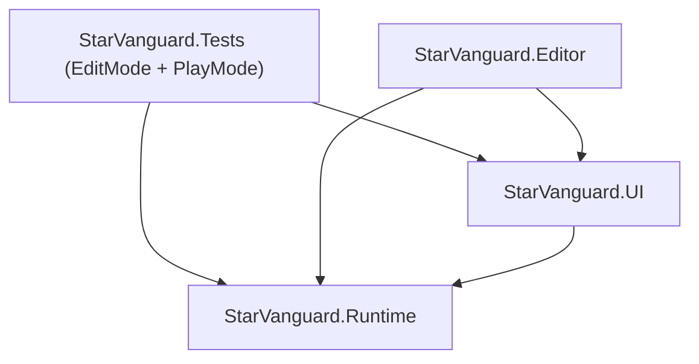

# 🧠 STAR VANGUARD — BỘ NHỚ DỰ ÁN (PROJECT MEMORY)

> **Cập nhật:** 02/11/2026 | **Phiên bản:** Unity 6000.5.7f1 | **Trạng thái:** Release Candidate (RC)
> Tài liệu này là Single Source of Truth (SSOT) lưu trữ toàn bộ kiến trúc, tiến độ kỹ thuật, quy tắc mã nguồn và nhật ký các quyết định hệ thống nhằm đảm bảo tính liền mạch giữa các phiên làm việc của AI Agent và Nhà phát triển.

---

## 1. Tổng quan & Stack công nghệ

| Thành phần | Đặc tả kỹ thuật |
| :--- | :--- |
| **Engine** | Unity **6000.5.7f1** (DirectX 11 / Metal) |
| **Render Pipeline** | Universal Render Pipeline (URP) 2D, Bloom Post-Processing, Vignette, Camera Shake |
| **UI Framework** | uGUI + TextMeshPro (TMP SDF Fonts), UITheme tập trung, 100% Zero-GC |
| **Input System** | Unity Input System 1.20 (activeInputHandler: Both) |
| **Netcode LAN Co-op** | **Unity Netcode for GameObjects (NGO) 2.5.0** + **Unity Transport 2.4.1** (theo ADR-002) |
| **Cấu trúc Scene** | `BootstrapScene` (Index 0) $\rightarrow$ `MainMenuScene` (Index 1) $\rightarrow$ `GameplayScene` (Index 2) |
| **Build Artifact** | Windows Standalone 64-bit: `Build/Windows/StarVanguard.exe` (~150 MB) |

---

## 2. Kiến trúc Assembly Definitions (asmdef)

Hệ thống tuân thủ nghiêm ngặt mô hình phân tách 1 chiều, tuyệt đối không có tham chiếu vòng (circular dependency):

1. **`StarVanguard.Runtime`** (`Assets/Scripts/StarVanguard.Runtime.asmdef`):
   * Chứa toàn bộ core gameplay: `GameManager`, `PlayerController`, `WeaponHeatController`, `PoolManager`, `AudioManager`, `LeaderboardManager`, `NetworkGameManager`, `NetworkPlayerController`.
   * **Quy tắc cứng:** Tuyệt đối không tham chiếu ngược lên `StarVanguard.UI` hoặc `StarVanguard.Editor`.
2. **`StarVanguard.UI`** (`Assets/Scripts/UI/StarVanguard.UI.asmdef`):
   * Quản lý router, theme và các màn hình: `UIPanelRouter`, `UITheme`, `MainMenuScreen`, `CoopScreen`, `CoopMenuPresenter`, `PauseScreen`, `SettingsScreen`, `GameOverScreen`, `OverheatGaugeUI`.
   * Giao tiếp với Runtime thông qua Public API hoặc lắng nghe C# events (`Action<T>`).
3. **`StarVanguard.Editor`** (`Assets/Editor/StarVanguard.Editor.asmdef`):
   * Chứa các công cụ kiểm thử tự động, build pipeline và dọn dẹp scene: `StarVanguardValidator`, `StarVanguardPlayModeSmoke`, `StarVanguardBuildPipeline`, `MainMenuPrefabPackager`.
4. **`StarVanguard.Tests`**:
   * Kiểm thử NUnit EditMode và PlayMode đảm bảo độ tin cậy của toàn bộ luồng scene và gameplay.

---

## 3. Hệ thống Thiết kế Giao diện (UI System & UITheme)

Toàn bộ UI đã được chuyển đổi sang chuẩn Sci-Fi hiện đại thông qua [`UITheme.cs`](file:///C:/Documents/UNITY%202026/Star%20Vanguard/Assets/Scripts/UI/UITheme.cs):

* **Bảng màu chủ đạo:**
  * Background: Dark Navy `#0B0E17` kết hợp Canvas Overlay mờ.
  * Border & Cards: Metallic Blue `#1C2B45` với viền bo tròn bo góc.
  * Accents: Neon Cyan `#00F0FF`, Warning Orange `#FF6B00`, Gold Record `#FFB800`, Danger `#FF4757`.
  * Typography: TextMeshPro SDF Fonts, kích thước phân cấp chuẩn (`H1: 34pt`, `H2: 26pt`, `Body: 18pt`, `Caption: 14pt`).

* **Danh mục các màn hình đã hoàn thiện:**
  1. **Main Menu (`MainMenuScreen.cs`):** Khung kim loại viền neon, danh mục 5 nút chiến dịch chính, hiệu ứng hover, quản lý độ phân giải và chuyển màn hình. Scene đã được đóng gói thành công thành các Prefabs độc lập (`MenuRoot.prefab`, `SettingsPanel.prefab`, `ControlsPanel.prefab`), giảm dung lượng scene từ 11,045 dòng xuống còn **1,853 dòng**.
  2. **Co-op LAN Menu (`CoopScreen.cs` & `CoopMenuPresenter.cs`):** Hỗ trợ Tạo phòng LAN (Host), Tìm & Gia nhập qua IP nội bộ (Join), hiển thị danh sách người chơi (Host/Client), quản lý trạng thái kết nối và xử lý nút Back an toàn.
  3. **Pause Menu In-Game (`PauseScreen.cs`):** Tích hợp 5 nút hành động: **TIẾP TỤC (RESUME)**, **CHƠI LẠI (RESTART)**, **CÀI ĐẶT (SETTINGS)**, **LƯU TIẾN TRÌNH (SAVE GAME)**, **VỀ MENU (MAIN MENU)**.
  4. **Settings Modal (`SettingsScreen.cs`):** 3 thanh trượt âm lượng mượt mà (Tổng / Nhạc nền / Hiệu ứng 0–100%), tùy chọn Bật/Tắt Toàn màn hình & Độ phân giải, bảng hướng dẫn phím bấm song ngữ.
  5. **Game Over Debrief Terminal (`GameOverScreen.cs`):** Hiển thị Điểm số chiến dịch (Final Score) cỡ lớn 52pt Cyan (định dạng phân tách số), Kỷ lục hiện tại, form nhập tên phi công lập kỷ lục mới (`TMP_InputField`) + Lưu điểm, Bảng vàng Top 5 Phi công xuất sắc (có fallback tự sinh dòng linh hoạt), các nút Chơi Lại, Cài Đặt, Về Menu.
  6. **HUD Zero-GC Overheat Gauge (`OverheatGaugeUI.cs`):** Loại bỏ hoàn toàn `OnGUI`, thanh trượt uGUI đổi màu động từ Cyan sang Đỏ khi quá nhiệt, kết nối sự kiện `OnHeatChanged(float)` không cấp phát rác bộ nhớ (Zero GC Alloc).

---

## 4. Kiến trúc Mạng Co-op LAN (ADR-002 NGO)

* **Lịch sử quyết định:**
  * `docs/ADR-001-coop.md`: Cắt bỏ hoàn toàn Mirror networking cũ do lỗi thời, nhiều dead code và nợ kỹ thuật.
  * `docs/ADR-002-netcode.md`: Tái triển khai Co-op LAN hiện đại bằng **Unity Netcode for GameObjects (NGO)** chính chủ từ Unity Technologies.
* **Các thành phần cốt lõi:**
  * `NetworkGameManager.cs`: Khởi tạo và quản lý vòng đời mạng, tự động gán `UnityTransport` (mặc định cổng `7777`), cung cấp API `StartHost()`, `StartClient(ipAddress)`, `Disconnect()`.
  * `NetworkPlayerController.cs`: Điều khiển phi thuyền trong mạng; Owner-authoritative movement kết hợp nội suy vị trí mượt mà, đồng bộ bắn đạn và máu thông qua NetworkVariable/RPCs.
  * Prefab mạng `Assets/Prefabs/Player_Network.prefab` đăng ký trong NetworkManager NetworkPrefabs list.

---

## 5. Quy chuẩn Kỹ thuật & Tiêu chuẩn "Zero Regression"

Trước khi hoàn tất bất kỳ commit nào, dự án bắt buộc phải vượt qua **3 Cổng kiểm chứng (3-Gate System)**:

| Cổng | Lệnh thực thi | Điều kiện Đạt |
| :--- | :--- | :--- |
| **G1 — Compile** | `refresh_unity` hoặc batchmode `-quit` | **0 Error**, 0 warning mới trong tất cả 5 asmdefs |
| **G2 — Hồi quy** | `StarVanguardValidator.ValidateAll` & `PlayModeSmoke.Run` | **100% Pass** (37/37 checks pass, exit code 0) |
| **G3 — Tĩnh** | `python Tools/check_project.py` | **0 FAIL**, cảnh báo không được gia tăng |

### Các quy tắc cấm kỵ (Hard Rules):
1. **Tuyệt đối KHÔNG** chỉnh sửa file YAML thô của `.unity`, `.prefab`, `.asset` bằng text editor hoặc regex.
2. **Tuyệt đối KHÔNG** tự tạo, xoá hoặc đổi tên file `.meta` thủ công lệch khỏi commit của file mã nguồn.
3. **Tuyệt đối KHÔNG** sử dụng toán tử fake-null `?.` hoặc `??` trên các đối tượng kế thừa `UnityEngine.Object`.
4. **Không** gọi `FindObjectsByType`, `Camera.main`, hoặc `new` cấp phát bộ nhớ trong các vòng lặp hot path (`Update`, `FixedUpdate`, đạn bắn, nổ bom).

---

## 6. Lộ trình phát triển tiếp theo (Next Milestones)

- [ ] **T-301:** Hoàn thiện tích hợp Input System 1.20 toàn diện cho tàu bay (Gamepad / Controller support & Key rebinding).
- [ ] **T-306:** Nâng cấp hệ thống Save / Leaderboard sang JSON định dạng chuẩn có `schemaVersion` và migration tự động.
- [ ] **T-501:** Chạy Profiler pass đo lường FPS và GC Allocation khi bắn đạn ở Wave 5 để tối ưu hóa triệt để.
- [ ] **T-503:** Bổ sung gói bản địa hóa đa ngôn ngữ (Tiếng Việt / English) đầy đủ ký tự dấu có fallback TMP Font.
