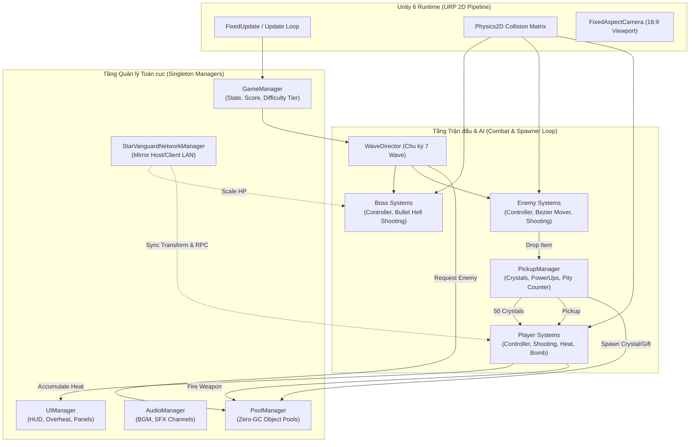
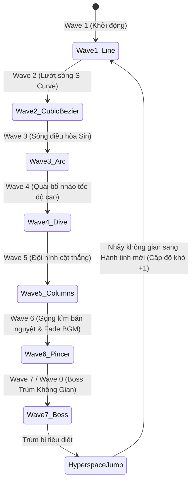
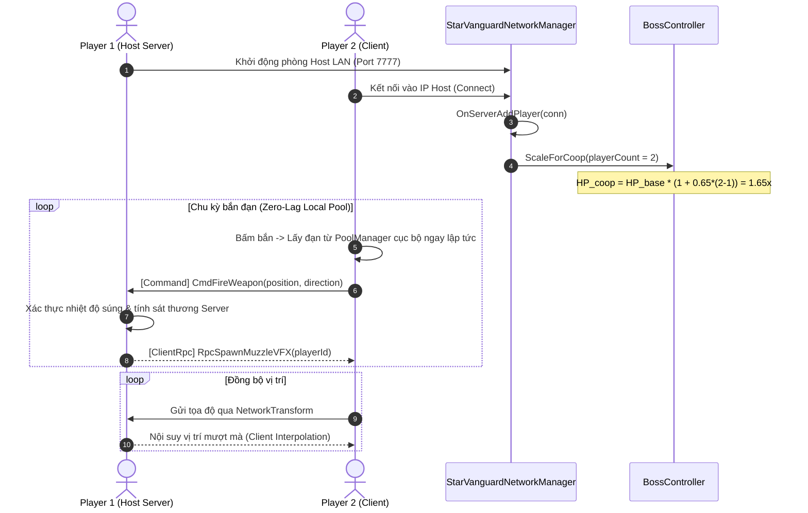

# 🏛️ 03. CẤU TRÚC GAME STAR VANGUARD (TECHNICAL GAME ARCHITECTURE)

Tài liệu này đặc tả toàn bộ kiến trúc phần mềm, các mẫu thiết kế (Design Patterns), luồng dữ liệu (Data Flow) và vòng đời hệ thống của dự án **Star Vanguard** trong Unity 6.

---

## 1. SƠ ĐỒ KIẾN TRÚC TỔNG THỂ (SYSTEM ARCHITECTURE DIAGRAM)

---

## 2. CÁC MẪU THIẾT KẾ CỐT LÕI (CORE DESIGN PATTERNS)

### 2.1. Phân Tách Scene-Bound vs Persistent Singleton (Kiến Trúc 3-Scene Bootstrap)
* **Triển khai tại:** [`Singleton.cs`](file:///c:/Documents/UNITY%202026/Star%20Vanguard/Assets/Scripts/Singleton.cs) và [`SingletonRegistry.cs`](file:///c:/Documents/UNITY%202026/Star%20Vanguard/Assets/Scripts/SingletonRegistry.cs)
* **Mô hình 3 Scene Phân Cấp:**
  1. **`BootstrapScene` (Build Index 0):** Nơi cư trú duy nhất của các Persistent Managers (`GameManager`, `AudioManager`, `PoolManager`, `LeaderboardManager`, `SettingsManager`). Khi khởi động, các manager này gọi `DontDestroyOnLoad` và [`BootstrapLoader.cs`](file:///c:/Documents/UNITY%202026/Star%20Vanguard/Assets/Scripts/BootstrapLoader.cs) ngay lập tức chuyển sang `MainMenuScene`.
  2. **`MainMenuScene` (Build Index 1):** Chỉ chứa giao diện Menu, Camera và nền sao. Hoàn toàn **không** chứa bản copy nào của persistent managers.
  3. **`GameplayScene` (Build Index 2):** Chỉ chứa thực thể chiến đấu (`Player`, `WaveDirector`) và các Scene-bound managers (`UIManager`, `ParallaxManager`). Hoàn toàn **không** chứa bản copy nào của persistent managers.
* **Đặc tính kỹ thuật:**
  * Thuộc tính `[SceneBoundSingleton]` và cờ `PersistAcrossScenes => false` đánh dấu các manager gắn liền vòng đời scene (`UIManager`, `WaveDirector`, `ParallaxManager`, `PlayerController`, `InterWaveMessageManager`).
  * Cấm tuyệt đối việc tự động tạo mới GameObject ma (`new GameObject()`) khi truy cập `.Instance` trong lúc scene đang unload hoặc thoát game.
  * Do không còn bản copy nào của persistent manager trong `MainMenuScene` và `GameplayScene`, cơ chế cảnh báo chuyển giao (Handover Notification) được triệt tiêu hoàn toàn.

### 2.2. Zero-Allocation Object Pooling Pattern
* **Triển khai tại:** [`PoolManager.cs`](file:///c:/Documents/UNITY%202026/Star%20Vanguard/Assets/Scripts/PoolManager.cs) và [`ObjectPool.cs`](file:///c:/Documents/UNITY%202026/Star%20Vanguard/Assets/Scripts/ObjectPool.cs)
* **Mục tiêu:** Tuyệt đối không gọi `Instantiate()` hoặc `Destroy()` trong lúc chơi game, đảm bảo rác bộ nhớ phát sinh trong `Update()` bằng 0 (Zero GC Alloc).
* **Danh mục các Pool được nạp sẵn khi khởi động game:**
  1. `BulletPool`: Đạn người chơi ($60$ viên).
  2. `EnemyBulletPool`: Đạn plasma của quái và bão đạn trùm ($120$ viên).
  3. `EnemyPool`: Đàn quái alien ($50$ đơn vị).
  4. `CrystalPool`: Tinh thể năng lượng rơi ($40$ viên).
  5. `ExplosionPool`: Hoạt cảnh nổ ($20$ thực thể).

### 2.3. Event Bus & Decoupled State Management
* **Cơ chế:** Quản lý chuyển đổi trạng thái bằng C# Action/Delegates thay vì gọi trực tiếp:
  * `GameManager.OnGameStateChanged`: Đồng bộ trạng thái `Menu`, `Playing`, `Paused`, `GameOver` đến `UIManager`, `WaveDirector` và `AudioManager`.
  * `WeaponHeatController.OnHeatChanged`: Bắn sự kiện nhiệt độ chuẩn hóa $H(t) \in [0.0, 1.0]$ trực tiếp lên thanh Overheat HUD mà không phụ thuộc ngược vào UI.
  * `WeaponHeatController.OnOverheatStateChanged`: Bật/tắt trạng thái khóa súng `isOverheated`.

---

## 3. CẤU TRÚC VÒNG LẶP CHIẾN DỊCH (WAVE DIRECTOR PROGRESSION)

Quá trình điều phối các đợt tấn công tại [`WaveDirector.cs`](file:///c:/Documents/UNITY%202026/Star%20Vanguard/Assets/Scripts/WaveDirector.cs) tuân theo công thức chu kỳ 7 wave tuần hoàn:

$$\text{WavePattern} = \text{WaveNumber} \pmod 7$$

1. **Wave 1 (`Wave_Line`):** Đội hình mạng lưới 8 cột $\times$ 5 hàng tiến chậm.
2. **Wave 2 (`Wave_CubicBezier`):** Đội hình lướt sóng Bézier bậc 3 uốn lượn hình chữ S từ 2 góc màn hình đổ dồn về đáy.
3. **Wave 3 (`Wave_Arc`):** Hàng quái dao động điều hòa theo hàm sin $y = A \sin(\omega t + \phi)$.
4. **Wave 4 (`Wave_Dive`):** Từng tốp quái khóa mục tiêu và bổ nhào thẳng xuống vị trí tàu người chơi.
5. **Wave 5 (`Wave_Columns`):** Các cột quái thả thẳng đồng loạt thử thách phản xạ né tránh.
6. **Wave 6 (`Wave_Pincer`):** Quái xuất phát từ hai mép màn hình, lượn theo cung tròn bán nguyệt khép góc pincer kẹp chặt tàu người chơi. Nhạc nền mờ dần (Fade out) chuẩn bị đánh trùm.
7. **Wave 7 (`Wave_Boss`):** Trùm không gian xuất hiện với 3 giai đoạn máu Bullet Hell. Tiêu diệt trùm sẽ kích hoạt hiệu ứng gia tốc Hyperspace (12 giây) và sang chu kỳ mới với độ khó tăng thêm.

---

## 4. MÔ HÌNH MẠNG CO-OP LAN SERVER-AUTHORITATIVE (TRACK C)

Được thiết kế cho 2 đến 4 người chơi phối hợp trên nền tảng **Mirror Networking**:

* **Khử độ trễ cục bộ (Client-Side Prediction):** Khi người chơi bấm bắn, đạn xuất hiện ngay lập tức từ `PoolManager` ở máy máy khách, tạo cảm giác mượt mà 100% không bị khựng chờ mạng.
* **Thẩm quyền máy chủ (Server Authority):** Server chịu trách nhiệm tính toán trừ máu quái và rơi vật phẩm để chống gian lận (anti-cheat).
* **Đồng bộ hóa đường bay quái bằng Hạt giống (Deterministic Seed):** Server chỉ phát tán `waveSeed` và `NetworkTime.time`. Tất cả máy Client tự nội suy đường cong Bézier $B(t)$ hoàn toàn độc lập, tiêu tốn **0 byte băng thông** trong lúc quái đang bay!
