# 🎯 04. TIẾN ĐỘ VÀ KẾ HOẠCH HÀNH ĐỘNG (PROGRESS & ACTION BACKLOG)

> ⚠️ **Đính chính 30/10/2026:** Phase 5 (Co-op LAN) được đánh dấu ✅ trong bản cũ nhưng **chưa bao giờ chạy được**
> (không có gói Mirror, code bọc trong `#if MIRROR` chưa từng được định nghĩa). Đã cắt bỏ theo
> [`docs/ADR-001-coop.md`](../docs/ADR-001-coop.md). Bảng dưới giữ nguyên lịch sử, riêng Phase 5 đã được sửa trạng thái.

Tài liệu này tổng hợp trạng thái tiến độ hiện tại theo 5 Phase lớn và danh mục công việc chi tiết (Backlog) đã được thống nhất để triển khai cho dự án **Star Vanguard**.

---

## 📊 1. BẢNG THEO DÕI TIẾN ĐỘ TỔNG THỂ (PHASE PROGRESS)

| Phase | Tên giai đoạn | Trách nhiệm chính | Tiến độ | Trạng thái |
| :-: | :--- | :--- | :-: | :---: |
| **Phase 1** | Chuẩn bị Mã nguồn & Môi trường Unity 6 | `@Architect` | 100% | ✅ Hoàn tất |
| **Phase 2** | Dịch ngược & Trích xuất Toàn diện `ChickenInvaders 5` | `@REA-Analyst` | 100% | ✅ Hoàn tất |
| **Phase 3** | Tái cấu trúc (Refactor) C# & 4 Hệ thống Toán học | `@Unity-Coder` | 100% | ✅ Hoàn tất |
| **Phase 4** | Cải tổ Mỹ thuật, Giao diện 1080p & Vũ khí REA | `@Asset-UI` + `@Unity-Coder` | 100% | ✅ Hoàn tất |
| **Phase 5** | ~~Kiến trúc Mạng Co-op Mirror~~ → **Đã cắt bỏ** 30/10/2026 (ADR-001): lớp mạng chưa từng biên dịch, game là 1 người | `@Net-Engineer` + `@Architect` | 100% (huỷ phạm vi) | ⛔ Huỷ theo ADR-001 |
| **Phase 6** | Tái cấu trúc 1080p, Nether Star & Tách Scene Menu | `@Unity-Coder` + `@Asset-UI` | 100% | ✅ Hoàn tất |
| **Phase 7** | Kiến trúc UITheme, UIPanelRouter & PlayMode Smoke Testing | `@Unity-Coder` + `@Architect` | 100% | ✅ Hoàn tất |
| **Phase 8** | Tách Dedicated Bootstrap Scene & Triệt Tiêu Bản Copy | `@Architect` + `@Unity-Coder` | 100% | ✅ Hoàn tất |

---

## 📝 2. DANH MỤC CÔNG VIỆC ĐÃ HOÀN TẤT & LỘ TRÌNH ĐÃ THỰC HIỆN

```mermaid
graph TD
    subgraph Sprint_1 ["Sprint 1: Chuẩn 1080p & Giao diện Overheat (HOÀN THÀNH)"]
        Task_Aspect["✅ Sửa FixedAspectCamera.cs sang 16:9 (1920x1080)"]
        Task_Bounds["✅ Mở rộng biên Viewport Player & Wave Spawner"]
        Task_OverheatUI["✅ Thiết kế Khung đo Quá nhiệt Overheat HUD"]
        Task_CrystalUI["✅ Thêm bộ đếm 50 Tinh thể Năng lượng -> Bom Plasma"]
    end

    subgraph Sprint_2 ["Sprint 2: Re-skin Mỹ thuật Sci-Fi (HOÀN THÀNH)"]
        Task_Logo["✅ Thiết kế Logo Star Vanguard mới ở Menu chính"]
        Task_Drones["✅ Tạo Sprite Alien Scout Drone thay cho Gà xanh"]
        Task_Boss["✅ Tạo Sprite Alien Dreadnought thay cho Gà trùm"]
        Task_Plasma["✅ Tạo Sprite Plasma Orb thay cho Đạn trứng"]
        Task_Parallax["✅ Nâng cấp Sprite nền sao 1920px chống mép đen"]
    end

    subgraph Sprint_3 ["Sprint 3: Mở rộng Kho Vũ khí theo Dữ liệu REA (HOÀN THÀNH)"]
        Task_Ion["✅ Red Laser (Đạn đỏ mặc định có lõi trắng)"]
        Task_Neutron["✅ Green Neutron Piercer (Đạn lục xuyên nhiều quái)"]
        Task_Vulcan["✅ Yellow Vulcan Chaingun (Đại liên quét tản mát PRNG)"]
        Task_Swarm["✅ Purple Plasma Wave (Đạn tỏa quạt tím đa hướng)"]
    end

    subgraph Sprint_4 ["Sprint 4: Âm thanh & Mạng Co-op LAN (HOÀN THÀNH)"]
        Task_SFX["✅ Tinh chỉnh độ cao âm vực Laser Sci-Fi theo từng vũ khí"]
        Task_Lobby["✅ Thiết kế Cyberpunk Menu Phòng chờ Co-op Host/Client"]
        Task_NetSync["✅ Đồng bộ bắn đạn Zero-GC Pool & [SyncVar] Điểm số, Mạng"]
        Task_WaveSync["✅ Đồng bộ hạt giống màn chơi WaveSeed & Scale máu Boss"]
    end

    subgraph Sprint_5 ["Sprint 5: Tách Scene, Nether Star & Khóa 1080p (HOÀN THÀNH)"]
        Task_Fit["✅ CanvasAspectFitter khóa cứng HUD vào Viewport 16:9"]
        Task_Rhythm["✅ Overheat Rhythm HUD nảy vi xung giật & Top HUD (Tim, Tên lửa, Điểm)"]
        Task_Star["✅ Nether Star Minecraft tăng cấp hỏa lực & 4 Hộp Quà đổi súng"]
        Task_Scenes["✅ Tách 2 Scene: MainMenuScene (Logo trên cao) & GameplayScene"]
    end

    subgraph Sprint_6 ["Sprint 6: UI Design System & PlayMode Testing (HOÀN THÀNH)"]
        Task_Theme["✅ UITheme: Design system 8px, typography 1080p, 9-slice neon sprites"]
        Task_Router["✅ UIPanelRouter: Stack navigation, cross-fade, giải quyết triệt để lỗi đè panel"]
        Task_Splitter["✅ StarVanguardSceneSplitter: Dọn sạch đối tượng rác giữa 2 scene"]
        Task_Smoke["✅ StarVanguardPlayModeSmoke: Test tự động headless 48/48 PASS (0 Fail)"]
    end

    subgraph Sprint_7 ["Sprint 7: Dedicated Bootstrap Scene & Zero-Copy Hardening (HOÀN THÀNH)"]
        Task_BootScene["✅ BootstrapScene (Build Index 0): Nơi cư trú duy nhất của Persistent Managers"]
        Task_BootLoader["✅ BootstrapLoader: Tự động nạp MainMenuScene và hỗ trợ additive trong Editor"]
        Task_Strip["✅ Dọn sạch 100% bản copy manager khỏi GameplayScene và MainMenuScene"]
        Task_Handover["✅ Triệt tiêu hoàn toàn thông báo chuyển giao dropped copy trong SingletonRegistry"]
        Task_Smoke55["✅ Test tự động nâng cấp đạt 55/55 PASS (0 Fail)"]
    end

    Sprint_1 --> Sprint_2
    Sprint_2 --> Sprint_3
    Sprint_3 --> Sprint_4
    Sprint_4 --> Sprint_5
    Sprint_5 --> Sprint_6
    Sprint_6 --> Sprint_7
```

---

## 🛠️ 3. CHI TIẾT KỸ THUẬT TỪNG HẠNG MỤC SPRINT

### Hạng mục 1: Chuẩn hóa 1920x1080 (16:9 Full HD)
* **Tệp cần chỉnh sửa:**
  * [`FixedAspectCamera.cs`](file:///c:/Documents/UNITY%202026/Star%20Vanguard/Assets/Scripts/FixedAspectCamera.cs): Thay đổi `public float targetAspect = 16f / 9f;` (thay vì `4f / 3f` cũ).
  * [`PlayerController.cs`](file:///c:/Documents/UNITY%202026/Star%20Vanguard/Assets/Scripts/PlayerController.cs): Mở rộng hộp giới hạn di chuyển $X_{\min}, X_{\max}$ khớp với tỉ lệ rộng của màn hình 16:9.
  * [`WaveDirector.cs`](file:///c:/Documents/UNITY%202026/Star%20Vanguard/Assets/Scripts/WaveDirector.cs): Mở rộng tọa độ xuất phát hai bên cánh của các đợt sóng Bézier và Pincer.

### Hạng mục 2: Khung hiển thị Quá nhiệt (Overheat Gauge HUD)
* **Kết nối trực tiếp:** [`WeaponHeatController.cs`](file:///c:/Documents/UNITY%202026/Star%20Vanguard/Assets/Scripts/WeaponHeatController.cs) $\leftrightarrow$ `UIManager.cs` / UI Toolkit.
* **Quy tắc hiển thị trực quan:**
  * Giá trị nhiệt độ $H \in [0.0, 1.0]$.
  * Màu sắc: Xanh ngọc ($< 40\%$) $\to$ Vàng ($40\% - 75\%$) $\to$ Đỏ cam ($> 75\%$).
  * Khi $H \ge 1.0$: Toàn bộ thanh chuyển sang trạng thái cảnh báo chớp nháy đỏ viền kèm dòng chữ nhấp nháy `SYSTEM OVERHEAT - WEAPON LOCKED` và phát âm thanh cảnh báo nhịp `overheatBeep`.

### Hạng mục 3: Bộ đếm 50 Tinh thể Năng lượng $\to$ Thưởng 1 Bom Plasma
* **Quy luật REA trích xuất:** Tương ứng với cơ chế 50 thịt đổi 1 tên lửa trong bản gốc.
* **Cập nhật:**
  * Bổ sung biến tích lũy `m_CurrentCrystalCharge` trong [`PlayerStats.cs`](file:///c:/Documents/UNITY%202026/Star%20Vanguard/Assets/Scripts/PlayerStats.cs).
  * Mỗi lần tàu nhặt [`EnergyCrystal`](file:///c:/Documents/UNITY%202026/Star%20Vanguard/Assets/Scripts/EnergyCrystal.cs), thanh đo năng lượng dâng lên.
  * Khi đạt mốc $50$: Thưởng ngay $+1$ quả bom Plasma vào kho vũ khí (`PlayerBombing`), phát âm thanh thưởng `PowerUp` và trừ $50$ năng lượng để tích lũy tiếp.

### Hạng mục 4: Re-skin Mỹ thuật (Logo, Alien Ships & Projectiles)
* **Logo Game:** Tạo file ảnh mới `StarVanguardLogo.png` với phong cách kim loại tương lai, chữ viền neon phát sáng.
* **Alien Drone (Thay cho Gà xanh):** Tàu trinh sát dạng đĩa bay/drone góc cạnh với lõi phát sáng màu đỏ/tím.
* **Alien Dreadnought (Thay cho Gà trùm):** Tàu mẹ chiến hạm bọc giáp dày với các khẩu pháo năng lượng bố trí 2 bên sườn.
* **Đạn Plasma (Thay cho Trứng):** Quả cầu plasma tím phát sáng.
* **Giữ nguyên `.meta`:** Khi thay thế các file ảnh trong `Assets/Sprites/`, áp dụng kỹ thuật overwrite nội dung PNG và giữ nguyên GUID `.meta` để Unity tự động nạp mà không mất prefab binding.

### Hạng mục 5: Hệ thống Đạn dược Đa dạng theo Dữ liệu REA
Triển khai thêm các mẫu đạn đã bóc tách từ nhị phân:
1. `Ion Blaster`: Đạn cơ bản 2 tia xanh.
2. `Neutron Piercer`: Đạn xanh lục xuyên qua quái nhỏ.
3. `Laser Cannon`: Tia cắt laser liên tục.
4. `Vulcan Chaingun`: Xả đạn liên thanh tốc độ cao với bộ lệch LCG.

---

## 📌 BƯỚC THỰC HIỆN TIẾP THEO NGAY LẬP TỨC
Ưu tiên thực hiện ngay **Sprint 1**:
1. Chuẩn hóa camera sang **16:9 (1920x1080)** trong [`FixedAspectCamera.cs`](file:///c:/Documents/UNITY%202026/Star%20Vanguard/Assets/Scripts/FixedAspectCamera.cs).
2. Tích hợp thanh **Overheat Gauge HUD** và bộ đếm **50 Tinh thể = Thưởng Bom** vào [`UIManager.cs`](file:///c:/Documents/UNITY%202026/Star%20Vanguard/Assets/Scripts/UIManager.cs).
3. Kiểm tra biên dịch đảm bảo duy trì trạng thái **0 Error(s)**!
